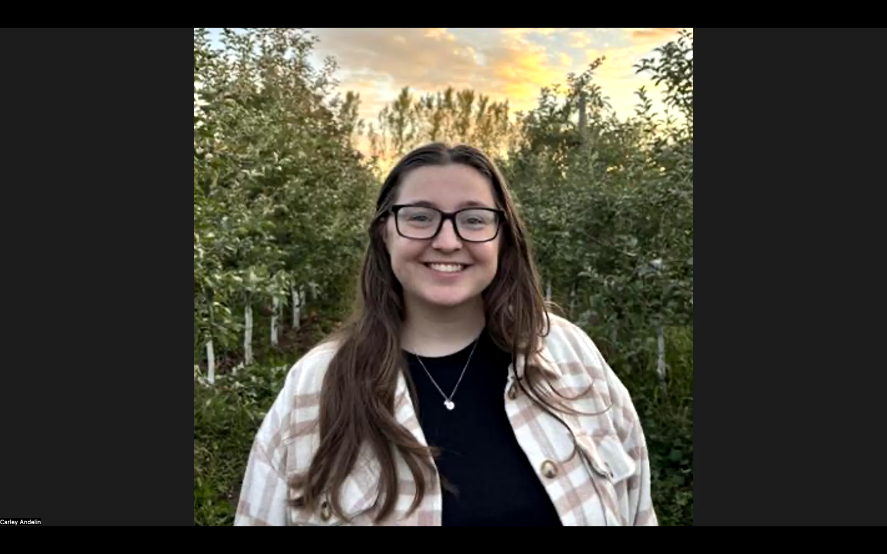
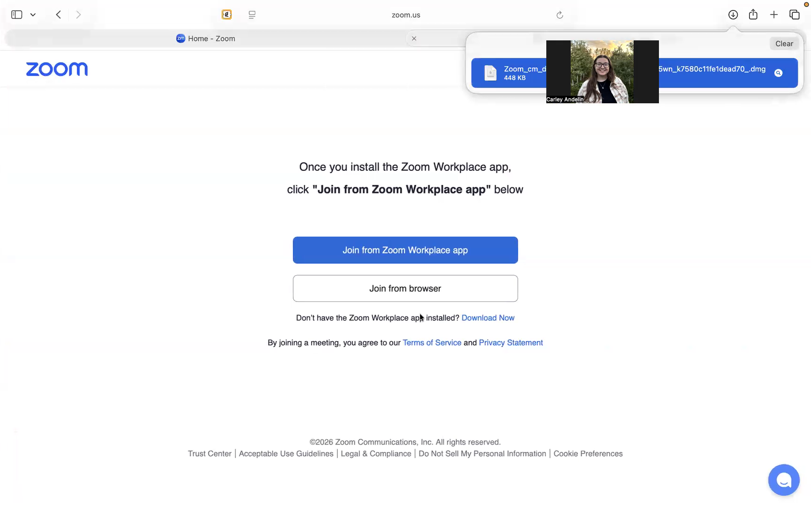
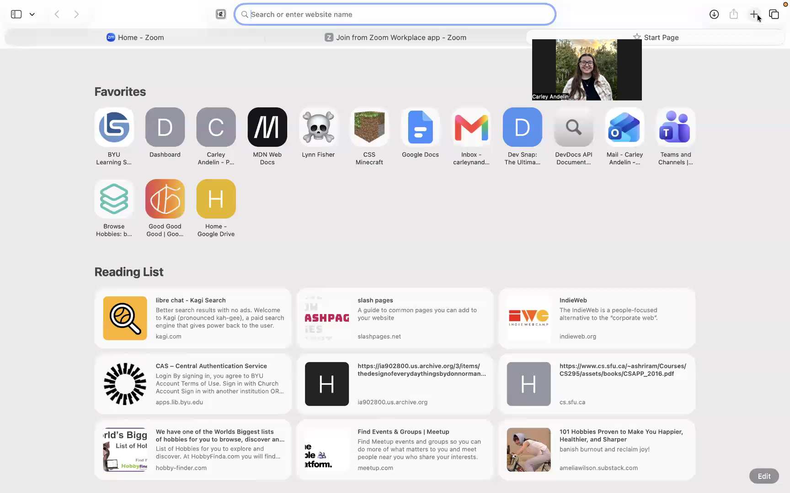
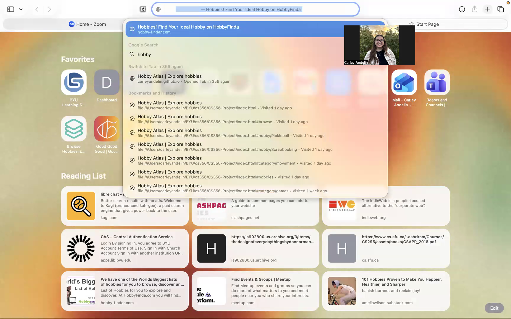
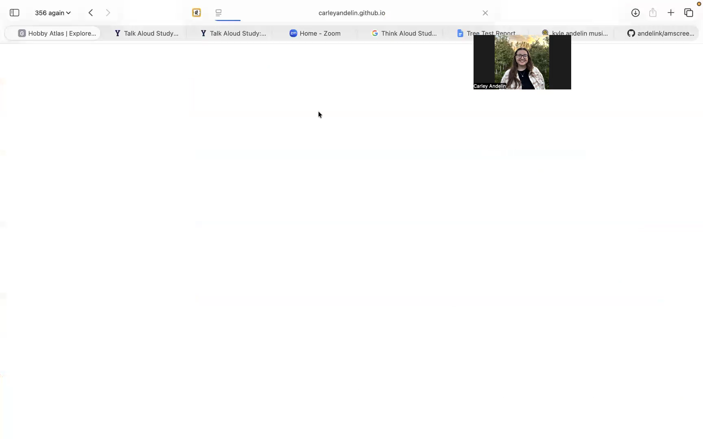
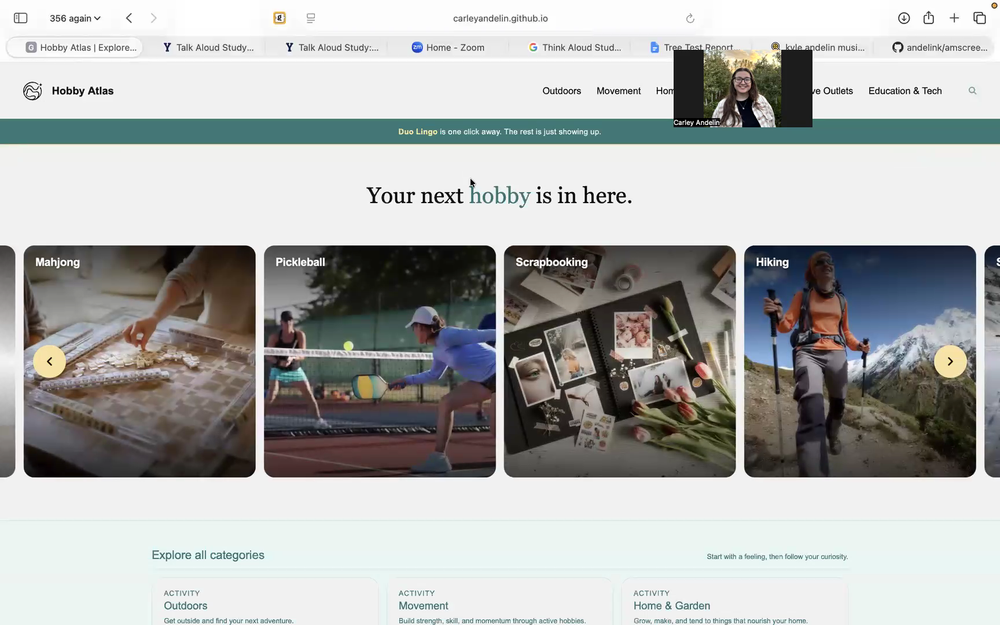

# Walkthrough: rosie.mp4

## [0:00]
- **0:03** "Hello. Hello. Test run. Test run."
- **0:07** "I'm going to test sharing the screen."
- **0:13** "And"

## [0:18]
- **0:18** "that works."
- **0:20** "Okay."

## [0:21]
- *(no speech)*

## [0:24]
- *(no speech)*

## [0:27]
- *(no speech)*

## [0:30]
- *(no speech)*

## [0:33]
- **0:33** "Stop share."
- **0:36** "Ending the test."

